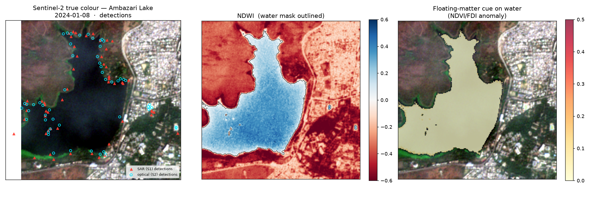
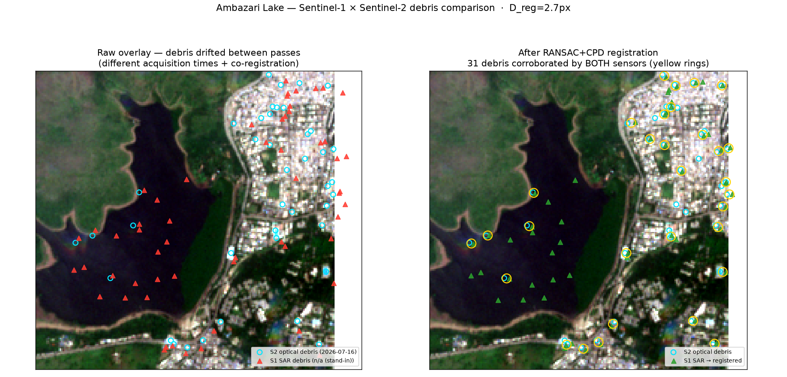
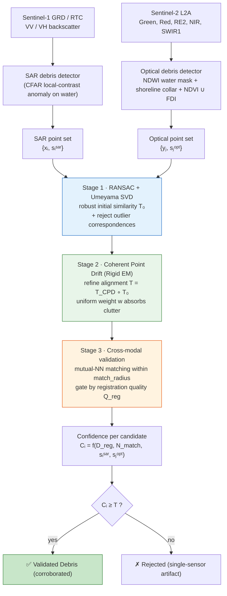
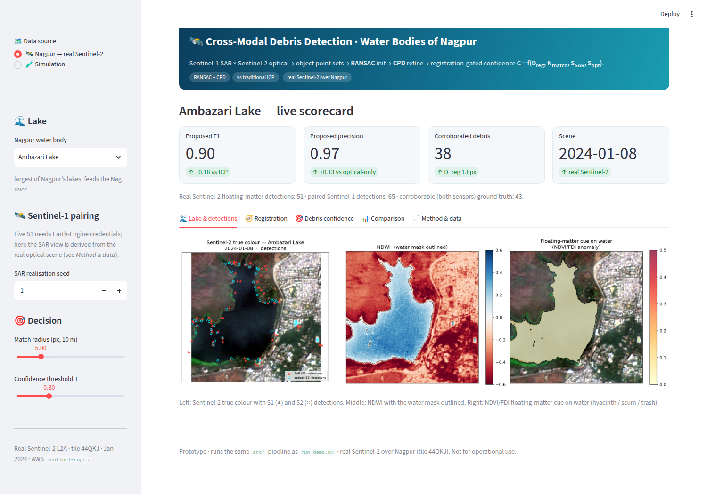
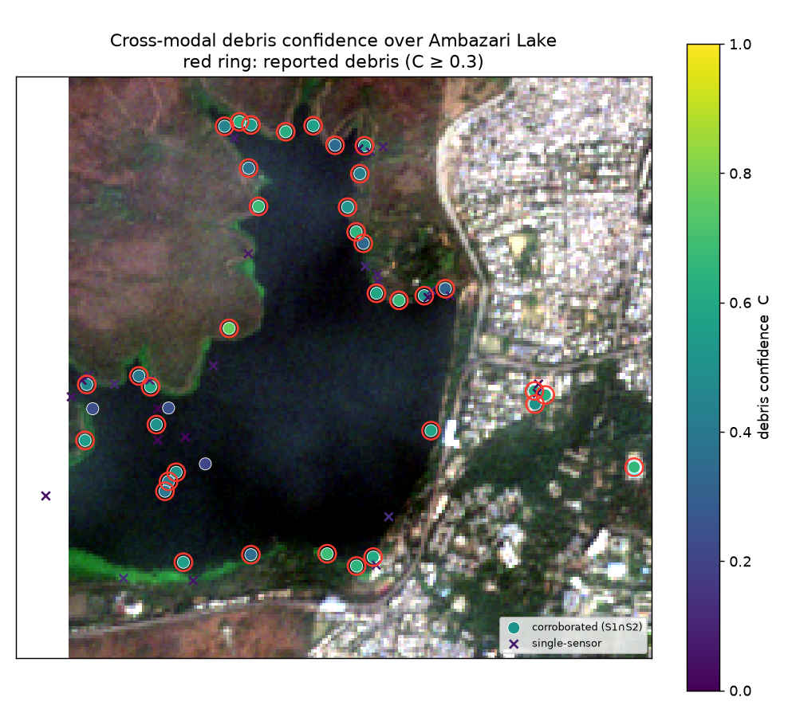
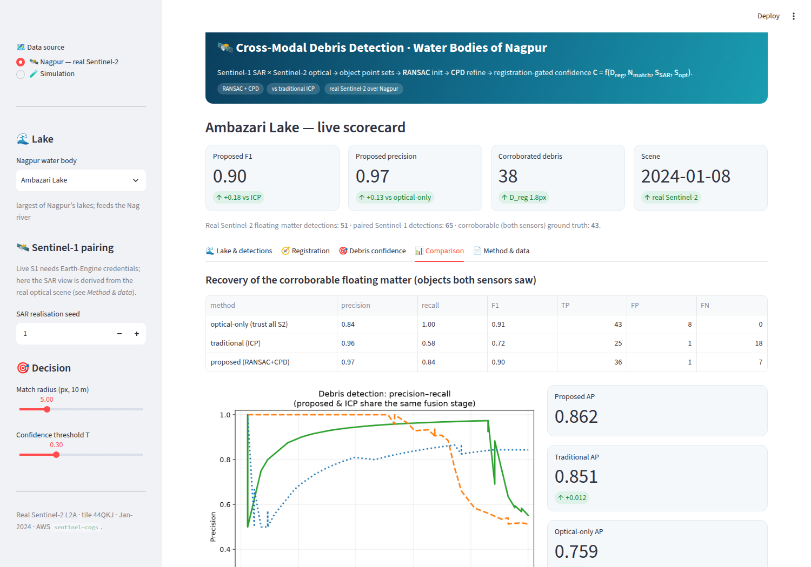
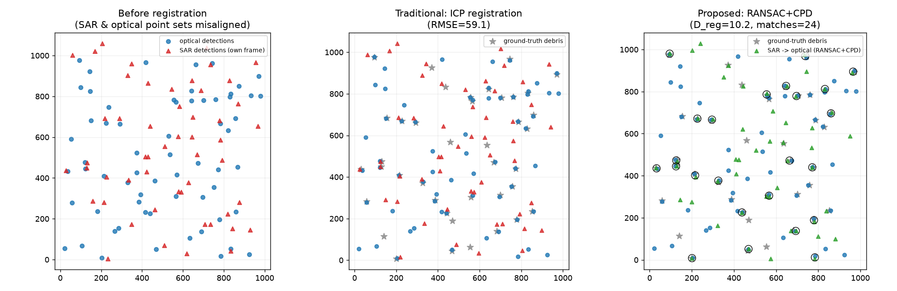
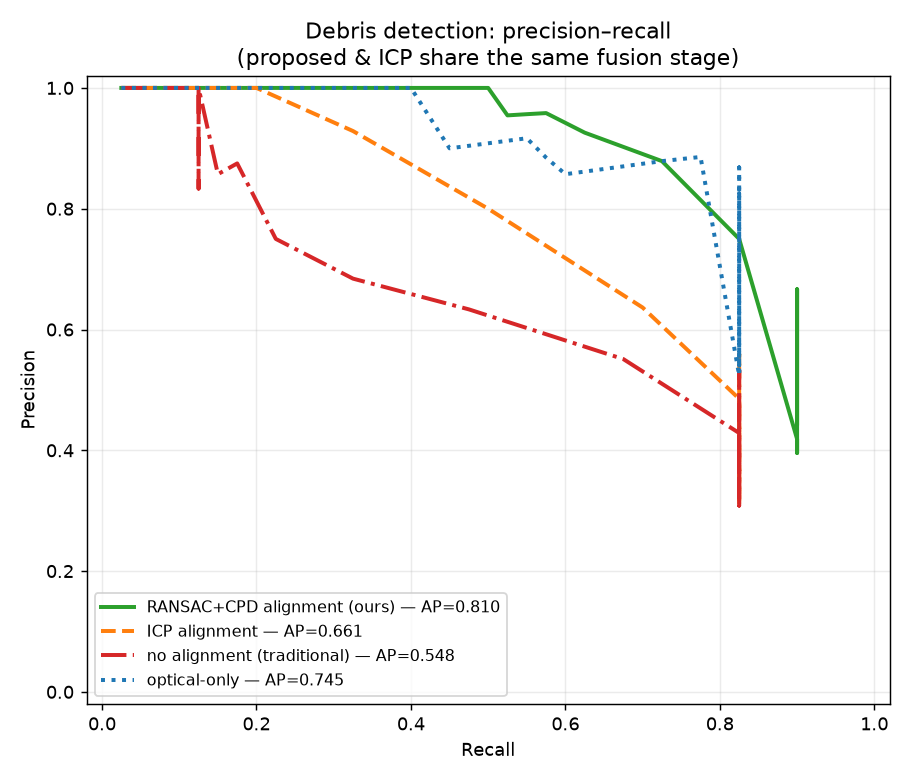
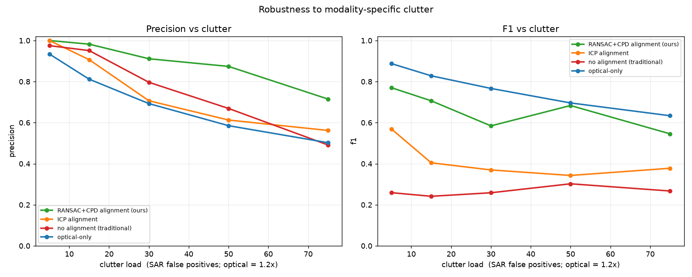

# Cross-Modal Sentinel-1 / Sentinel-2 Debris Detection — Water Bodies of Nagpur

**A research prototype that detects floating debris and macro-matter on Nagpur's lakes by
fusing Sentinel-1 SAR and Sentinel-2 optical satellite data through a
RANSAC-initialised Coherent Point Drift (CPD) cross-modal validation pipeline —
benchmarked against the traditional ICP method and single-sensor optical baselines.**

> Runs on **real, live Sentinel-2 L2A imagery** of the Nagpur lakes (read straight
> from the Copernicus/AWS open COG bucket) paired with **live Sentinel-1 RTC SAR**
> (via Microsoft Planetary Computer / Google Earth Engine, or an offline drift stand-in),
> and ships an interactive Streamlit dashboard, CLI overlay utility, and reproducible benchmark suite.

---

## Table of contents
1. [What this project does](#1-what-this-project-does)
2. [Why Nagpur's water bodies](#2-why-nagpurs-water-bodies)
3. [Live satellite data & acquisition techniques](#3-live-satellite-data--acquisition-techniques)
4. [System flowchart](#4-system-flowchart)
5. [Remote sensing & registration techniques](#5-remote-sensing--registration-techniques)
6. [Methodology — the three-stage pipeline & mathematical formulation](#6-methodology--the-three-stage-pipeline--mathematical-formulation)
7. [The interactive dashboard (screenshots & modes)](#7-the-interactive-dashboard-screenshots--modes)
8. [Evaluation protocol & benchmark results](#8-evaluation-protocol--benchmark-results)
9. [Conclusions](#9-conclusions)
10. [Quick start](#10-quick-start)
11. [Repository layout](#11-repository-layout)
12. [Limitations & future work](#12-limitations--future-work)
13. [References](#13-references)

---

## 1. What this project does

Floating matter on inland lakes — **water hyacinth blooms, algal scum, plastic and mixed
trash rafts, shoreline litter** — is visible to two physically distinct Sentinel
sensors:

* **Sentinel-2 (Multi-Spectral Optical)** detects floating matter through its **spectral** signature:
  a Near-Infrared (NIR) vegetation bump (`NDVI`) or a sub-pixel NIR peak above the Red-Edge to Short-Wave Infrared baseline (`FDI` — Floating Debris Index).
  * *Single-sensor false alarms:* sun-glint, turbid sediment plumes, thin cloud/haze, and shallow bottom reflectance.
* **Sentinel-1 (C-Band Synthetic Aperture Radar — SAR)** detects floating matter through the way it **modulates water-surface roughness**:
  floating mats alter capillary/Bragg waves and produce localized radar backscatter anomalies in VV/VH polarization.
  * *Single-sensor false alarms:* boats/wakes, wind streaks, and shoreline double-bounce radar returns.

Each sensor alone raises **modality-specific false alarms** that the other does not. The core idea of this project is to:
1. Run an **independent detector on each modality** and convert pixel anomalies into **object-level point sets** (centroids + detection strengths).
2. Align the two point sets using a **robust two-stage registration (RANSAC $\rightarrow$ Rigid CPD)** to compensate for **inter-pass surface drift** (since S1 and S2 image at different times) and residual co-registration offsets.
3. Use the **post-registration spatial agreement** between the two sensors as a **cross-modal debris validation** mechanism gated by global registration quality.

```text
Stage 0  Putative Matching  →  Mutual-Nearest-Neighbours (geocoded) or Shape-Context Descriptors
Stage 1  RANSAC + Umeyama   →  Robust coarse similarity alignment T₀ + gross outlier rejection
Stage 2  Rigid CPD (EM)     →  Probabilistic GMM refinement T = T_CPD ∘ T₀ with uniform clutter absorption
Stage 3  Cross-Modal Fusion →  Registration-gated confidence C = f(D_reg, N_match, S_SAR, S_opt) → Debris map
```

We compare this proposed pipeline against the **traditional method** (classical Iterative Closest Point — **ICP** registration sharing the exact same Stage 3 fusion) and a **single-modality** baseline (**optical-only**).

---

## 2. Why Nagpur's water bodies

Nagpur, the "City of Lakes" (Maharashtra, India), has a set of historic tanks and
reservoirs that suffer from **water-hyacinth proliferation, sewage-driven algal scum, and
floating solid waste** — a real, local environmental-monitoring problem well
suited to satellite fusion. All major lakes fall inside a **single Sentinel-2 MGRS
tile, `44QKJ`** (UTM zone 44N / `EPSG:32644`), which the pipeline reads directly.

| Lake | Approx. centre (lat, lon) | Window size (10 m px) | Notes |
|------|---------------------------|:---------------------:|-------|
| **Ambazari Lake** | `21.131, 79.043` | ~220 × 220 | Largest lake; feeds the Nag river; prone to western-shore hyacinth mats |
| **Futala Lake** | `21.150, 79.045` | ~110 × 110 | Central urban recreational tank |
| **Gorewada Lake** | `21.204, 79.030` | ~200 × 200 | Northern drinking-water reservoir |
| **Gandhisagar (Shukrawari)** | `21.153, 79.100` | ~90 × 90 | Historic rectangular tank in the old city |
| **Sonegaon Lake** | `21.101, 79.053` | ~90 × 90 | South-west urban lake |
| **Telangkhedi Lake** | `21.155, 79.053` | ~110 × 110 | Near Seminary Hills |
| **Sakkardara Lake** | `21.125, 79.118` | ~80 × 80 | Historic tank, east |
| **Naik Lake** | `21.136, 79.108` | ~70 × 70 | Small urban tank, weed-prone |

Coordinates and bounding boxes are configured in [`src/nagpur.py`](src/nagpur.py).

---

## 3. Live satellite data & acquisition techniques

| Modality | Product | Source & Technique | Live status |
|----------|---------|--------------------|-------------|
| **Sentinel-2 (Optical)** | L2A surface reflectance (`B02`, `B03`, `B04`, `B06`, `B08`, `B11`, `SCL`) | Public AWS Open Data bucket `s3://sentinel-cogs` (Copernicus mirror), MGRS tile `44QKJ` | ✅ **Real & live** — streamed directly by [`src/acquire.py`](src/acquire.py) via GDAL `/vsicurl` HTTP byte-range reads (no credentials required). `fetch_latest_clear_s2` scans backward from today and checks the L2A `SCL` cloud mask to pull the newest clear pass. Five Nagpur lakes are also **bundled** in `data/nagpur_<key>_s2.npz` for offline use. |
| **Sentinel-1 (SAR — Live RTC)** | Radiometrically Terrain-Corrected (RTC) VV/VH backscatter ($\gamma^0$, dB) | **Microsoft Planetary Computer** STAC (`sentinel-1-rtc`) | ✅ **Real & live** — [`fetch_latest_s1_pc`](src/acquire.py) queries Planetary Computer anonymously, signs asset URLs via `planetary-computer`, and warps VV/VH onto the exact 10 m optical grid using `rioxarray`. |
| **Sentinel-1 (SAR — GEE / Stand-in)** | GRD VV/VH ($\gamma^0$, dB) or derived drift point cloud | **Google Earth Engine** (`COPERNICUS/S1_GRD`) or [`simulate_sar_pointset`](src/detect_real.py) | ⚙️ **Real via `fetch_sentinel1_ee`** (with `earthengine authenticate`), or **offline stand-in** where an independent, noisy, drifted SAR sample + shoreline clutter is derived from the real optical detections to enable quantitative Precision/Recall benchmarking. |

The bundled scenes are genuine Sentinel-2 L2A windows over each lake (e.g. Ambazari
= `S2A_44QKJ_20240108`, 2024-01-08). The image below is **real Sentinel-2 data**
of Ambazari Lake with the NDWI water mask and the floating-matter cue:



*Left — Sentinel-2 true colour with the two sensors' detections (▲ SAR, ○
optical). Middle — NDWI, water mask outlined; the lake is cleanly segmented.
Right — the NDVI/FDI floating-matter cue on water, which lights up along the weedy
western fingers of the lake where hyacinth accumulates.*

### Latest-scene S1 × S2 overlay (drift-aware) — `fetch_and_overlay.py`

`python fetch_and_overlay.py --lake ambazari` fetches the **most recent low-cloud
Sentinel-2** scene and the **latest Sentinel-1** scene over the lake, detects
debris in each, and overlays them. Because the two sensors image at *different
times*, floating debris **drifts** between passes — the RANSAC+CPD step estimates
that drift and aligns the two debris clouds so genuine debris seen by **both**
sensors can be matched:



*Real Sentinel-2 of Ambazari Lake (2026-07-16). **Left** — raw overlay: S2 optical
(○ cyan) and S1 SAR (▲) debris are offset by the inter-pass drift + co-registration.
**Right** — after RANSAC+CPD registration the SAR (▲ green) lines up with the
optical, and the ~30 debris seen by **both** sensors are ringed in yellow. The
script reports the estimated drift (here ≈ 100 m) and the S1–S2 time gap.*

---

## 4. System flowchart



**Traditional method (baseline):** identical architecture, except Stages 1–2 are replaced by a
single **ICP** registration (cold-started at identity, no outlier model) — isolating the exact contribution of
RANSAC+CPD because Stage 3 is held fixed.

---

## 5. Remote sensing & registration techniques

### 5.1 Remote sensing detectors $\rightarrow$ Object point sets ([`src/detect_real.py`](src/detect_real.py))
Working at the **object level** rather than raw pixels is deliberate: floating debris forms discrete rafts/mats, S1 and S2 have different spatial characteristics and revisit times, and point-set registration naturally aligns discrete object clouds under drift and outlier contamination.

1. **Water Masking — NDWI (McFeeters, 1996) + Morphological Dilation:**
   $$\text{NDWI} = \frac{\text{Green (B03)} - \text{NIR (B08)}}{\text{Green (B03)} + \text{NIR (B08)}}$$
   Pixels with $\text{NDWI} > -0.05$ are classified as open water, cleaned with binary opening/closing, and expanded by a 1-pixel (10 m) morphological dilation collar to include shoreline-accumulated litter.
2. **Floating Vegetation / Algal Scum — NDVI:**
   $$\text{NDVI} = \frac{\text{NIR (B08)} - \text{Red (B04)}}{\text{NIR (B08)} + \text{Red (B04)}}$$
   Flags chlorophyll-rich hyacinth mats and surface scum on water ($\text{NDVI} > 0.08$).
3. **Floating Plastic / Macro-Debris — FDI (Biermann et al., 2020):**
   $$\text{FDI} = R_{\text{NIR (B08)}} - \left[ R_{\text{RE2 (B06)}} + \left(R_{\text{SWIR1 (B11)}} - R_{\text{RE2 (B06)}}\right) \cdot \frac{\lambda_{\text{NIR}} - \lambda_{\text{Red}}}{\lambda_{\text{SWIR1}} - \lambda_{\text{Red}}} \cdot 10 \right]$$
   Captures the NIR reflectance spike above the Red-Edge (740 nm) to SWIR (1610 nm) baseline caused by floating plastic and non-vegetative debris ($\text{FDI} > 0.012$).
4. **SAR Roughness Anomaly — CFAR-Style Local Contrast Detector:**
   Over water pixels on Sentinel-1 VV backscatter, computes a sliding $9 \times 9$ local median $\mu_{\text{med}}$ and fast box-filter local standard deviation $\sigma_{\text{local}} = \sqrt{\mathbb{E}[\text{VV}^2] - \mathbb{E}[\text{VV}]^2}$:
   $$|\text{VV} - \mu_{\text{med}}| > k \cdot \sigma_{\text{local}} \quad (k = 2.5)$$
5. **Connected-Component Extraction (`_blobs`):**
   8-connected components of the binary anomaly masks (filtered by minimum/maximum blob area) are reduced to **intensity-weighted centroids** $\mathbf{x}_i, \mathbf{y}_j \in \mathbb{R}^2$ and normalized strengths $s_i^{\text{SAR}}, s_j^{\text{opt}} \in [0, 1]$.

### 5.2 Putative correspondence techniques ([`src/registration.py`](src/registration.py))
* **Spatial Mutual-Nearest-Neighbours (`spatial_putative_matches`):** Default for geocoded Sentinel passes where inter-pass drift is a bounded residual offset. Uses `scipy.spatial.cKDTree` to pair points $(i, j)$ that are mutual nearest neighbours within `putative_radius`.
* **Rotation/Scale-Invariant Shape-Context Descriptors (`shape_context_descriptors` + `putative_matches`):** For un-geocoded scenes with large arbitrary transforms, describes each point by the sorted, mean-normalized distances to its $k$ nearest neighbours, matched in descriptor space using mutual-NN and **Lowe's second-nearest neighbour ratio test** ($\text{ratio} \le 0.95$).

### 5.3 Stage 1: RANSAC + Umeyama closed-form similarity (`ransac_similarity`)
* Repeatedly samples minimal sets of 2 putative correspondences.
* Estimates a 4-DOF 2D similarity transform (isotropic scale $s$, rotation matrix $\mathbf{R}$ with reflection guard $\det(\mathbf{U}\mathbf{V}^T)$, and translation $\mathbf{t}$) in closed form via **Umeyama's SVD theorem (1991)** (`estimate_similarity`).
* Counts inliers within residual threshold (`ransac_threshold`), retains the largest consensus set, and refits $\mathbf{T}_0$ on all inliers.
* **Key role:** Hard outlier rejection — prevents modality-specific clutter from biasing the initial alignment.

### 5.4 Stage 2: Coherent Point Drift (`cpd_rigid`) — probabilistic EM registration
* Based on **Myronenko & Song (IEEE TPAMI, 2010)**, warm-started at the RANSAC transform $\mathbf{T}_0$.
* Models the transformed SAR point set as Gaussian Mixture Model (GMM) centroids moving coherently toward the optical target distribution, with an explicit **uniform noise component weighted by $w \in [0, 1)$** (default $w = 0.4$) that absorbs residual outliers.
* **E-step:** Computes soft correspondence probabilities $P_{mn}$ between SAR point $m$ and optical point $n$:
  $$P_{mn} = \frac{\exp\!\left(-\frac{\|\mathbf{x}_n - \mathbf{T}(\mathbf{y}_m)\|^2}{2\sigma^2}\right)}{\sum_{k=1}^{M} \exp\!\left(-\frac{\|\mathbf{x}_n - \mathbf{T}(\mathbf{y}_k)\|^2}{2\sigma^2}\right) + (2\pi\sigma^2)^{D/2}\,\frac{w}{1 - w}\,\frac{M}{N}}$$
* **M-step:** Solves for the rigid rotation $\mathbf{R}$, translation $\mathbf{t}$, and variance $\sigma^2$ in closed form via SVD of the soft-weighted cross-covariance matrix.
* **Preventing Scale-Shrink Degeneracy:** Because RANSAC already estimates scale in Stage 1, CPD runs with `allow_scale=False` (pure rigid refinement), eliminating the classic GMM scale-collapse failure mode ($\sigma^2 \to 0$) while refining alignment over the full point clouds.

### 5.5 Traditional baseline: Iterative Closest Point (`icp_rigid`)
* Iteratively hard-assigns every SAR point to its nearest optical neighbour and refits a similarity transform from the identity initialisation.
* Because ICP has **no outlier model** and uses hard nearest-neighbour snapping, ships, wakes, and sun-glint act as phantom attractors that drag the registration off.

---

## 6. Methodology — the three-stage pipeline & mathematical formulation

The guiding design principle is a **strict division of labour** across stages:

| Stage | Algorithm | Distinct Non-Redundant Role |
|-------|-----------|-----------------------------|
| **1** | **RANSAC + Umeyama** | Robust **coarse** global transform $\mathbf{T}_0$ + explicit rejection of gross outlier correspondences |
| **2** | **Rigid CPD (EM)** | **Fine** probabilistic alignment $\mathbf{T} = \mathbf{T}_{\text{CPD}} \circ \mathbf{T}_0$ using soft global evidence; uniform term $w$ absorbs remaining clutter |
| **3** | **Cross-Modal Validation** | Mutual-NN matching of registered points, **registration-quality gating ($Q_{\text{reg}}$)**, and confidence scoring $C_i$ |

### Registration-Gated Confidence Score ([`src/fusion.py`](src/fusion.py))
After registering SAR into the optical frame ($\tilde{\mathbf{x}}_i = \mathbf{T}(\mathbf{x}_i)$) and matching via mutual-NN within `match_radius`, each candidate is scored:

$$C_i = \begin{cases} Q_{\text{reg}} \cdot \left[\alpha\,g_i + \beta\,s_i^{\text{SAR}} + \gamma\,s_i^{\text{opt}}\right] & \text{(corroborated cross-modal pair, } \alpha + \beta + \gamma = 1\text{)} \\[6pt] Q_{\text{reg}} \cdot \text{penalty} \cdot \dfrac{w_{\text{sensor}}}{\beta + \gamma} \cdot s_i^{(\text{single})} & \text{(uncorroborated single-sensor candidate)} \end{cases}$$

where:
* **Global Registration-Quality Gate:**
  $$Q_{\text{reg}} = \exp\!\left(-\frac{D_{\text{reg}}^2}{2\tau^2}\right) \cdot \min\!\left(1, \frac{N_{\text{matches}}}{N_{\text{support}}}\right)$$
* **Geometric Pair Agreement:**
  $$g_i = \exp\!\left(-\frac{d_i^2}{2s_{\text{geom}}^2}\right), \quad d_i = \|\tilde{\mathbf{x}}_i - \mathbf{y}_j\|_2, \quad s_{\text{geom}} = \frac{\text{match\_radius}}{2}$$
* $D_{\text{reg}} = \sqrt{\frac{1}{N_{\text{matches}}}\sum d_i^2}$ is the global post-registration RMSE across matched pairs.
* Default parameters: $\alpha = 0.45$, $\beta = 0.275$, $\gamma = 0.275$, $\tau = 25.0$, $N_{\text{support}} = 6$, $\text{penalty} = 0.35$, decision threshold $T = 0.30$.

**Why $Q_{\text{reg}}$ is essential:** It multiplies **every** candidate's confidence. If the two sensors cannot be aligned ($D_{\text{reg}}$ is large) or too few objects corroborate ($N_{\text{matches}} < N_{\text{support}}$), $Q_{\text{reg}} \to 0$, ensuring a failed registration cannot manufacture confident debris. Full derivation: [`docs/METHODOLOGY.md`](docs/METHODOLOGY.md).

---

## 7. The interactive dashboard (screenshots & modes)

Run `streamlit run app.py`. The sidebar offers two primary data modes:
* **🛰️ Nagpur — real Sentinel-2** (with choice of **📡 Microsoft Planetary Computer (live)** SAR or **⚙️ Derived from optical (offline stand-in)** SAR)
* **🧪 Simulation** (parametric synthetic benchmark)

> **Note on Live vs. Stand-in / Simulation Precision–Recall Graphs:**
> When running with **both live Sentinel-2 and live Sentinel-1 (Planetary Computer)**, real-time satellite feeds do not come with pre-annotated human ground-truth labels (`true_debris` is empty). In that live regime, inspect detections and drift in the **🛰️ S1×S2 overlay** and **🎯 Debris confidence** tabs. To evaluate quantitative Precision/Recall/F1 tables and PR curves on real lake scenes, switch the SAR source dropdown to **⚙️ Derived from optical (offline stand-in)** or switch to **🧪 Simulation** mode.

### Nagpur mode — lake, detections, and live scorecard


Pick a Nagpur lake; the app loads the **real Sentinel-2 scene**, runs the water
mask and floating-matter detectors, pairs a Sentinel-1 view, and runs the full
pipeline. The scorecard shows the proposed method's F1 / precision with the delta
against the traditional ICP method and the optical-only baseline, the number of
**corroborated** debris, and the registration error `D_reg` (in 10 m pixels).

### Debris confidence over the lake image


Cross-modal debris confidence painted over the true-colour lake. **Green points =
corroborated by both sensors (high `C`)** and get a **red ring (reported debris)**;
**purple ✗ = single-sensor detections**, correctly down-weighted. This is the
validation mechanism working on real Nagpur data: the pipeline confirms the weedy
shoreline mats seen by both sensors and rejects the single-sensor artifacts.

### Method comparison


Metrics table + precision–recall curves for all three methods, and average
precision. The proposed method (RANSAC+CPD) dominates the high-precision region.

---

## 8. Evaluation protocol & benchmark results

Implemented in [`src/evaluate.py`](src/evaluate.py), reported debris locations are matched one-to-one against ground-truth locations within `match_radius` via a greedy `cKDTree` search (`score_locations`) to compute $TP$, $FP$, $FN$, Precision, Recall, $F_1$, threshold-swept Precision–Recall curves, and trapezoidal Average Precision ($\text{AP}$).

### 8.1 Real Nagpur lakes (Sentinel-2 optical real; SAR paired; averaged over SAR realisations)

| Lake | Method | Precision | Recall | F1 |
|------|--------|:---:|:---:|:---:|
| **Ambazari** | optical-only | 0.80 | 1.00\* | 0.89 |
| | traditional (ICP) | 0.92 | 0.68 | 0.77 |
| | **proposed (RANSAC+CPD)** | **0.94** | **0.81** | **0.87** |
| **Gorewada** | optical-only | 0.81 | 1.00\* | 0.90 |
| | traditional (ICP) | 0.94 | 0.68 | 0.78 |
| | **proposed (RANSAC+CPD)** | **0.96** | **0.79** | **0.87** |
| **Futala** | optical-only | 0.81 | 1.00\* | 0.89 |
| | traditional (ICP) | 0.89 | 0.74 | 0.80 |
| | **proposed (RANSAC+CPD)** | **0.89** | **0.74** | **0.80** |

*Ground truth = floating matter visible to **both** sensors (the *corroborable*
objects). \*Optical-only trivially reaches recall ≈ 1 because that truth set is a
subset of its own detections — so **precision** is the meaningful axis for it: it
reports every floating-matter blob, including ~20 % single-sensor artifacts it
cannot reject.*

* **Cross-modal validation raises precision from ≈ 0.80 (optical-only) to
  0.94–0.96** — it roughly **halves the false-alarm rate** by requiring SAR
  corroboration.
* **The proposed method beats the traditional ICP method** on the larger lakes
  (Ambazari, Gorewada): **F1 0.87 vs 0.77–0.78**, driven by higher recall
  (0.79–0.81 vs 0.68) at equal-or-better precision — RANSAC+CPD registers the two
  point sets more accurately than ICP, so more true corroborations are recovered.
  On tiny Futala (few detections) the two tie, as expected when there is little
  for robust registration to improve.

### 8.2 Controlled simulation (20 seeds — isolates the algorithm)

| Method | Precision | Recall | F1 | Average Precision |
|--------|:---:|:---:|:---:|:---:|
| optical-only | 0.74 | 0.81 | 0.77 | 0.74 |
| traditional (ICP) | 0.75 | 0.29 | 0.40 | 0.64 |
| **proposed (RANSAC+CPD)** | **0.91** | 0.52 | **0.65** | **0.79** |

Here the proposed method **dominates the traditional ICP method on every metric**
(F1 0.65 vs 0.40, AP 0.79 vs 0.64) — same fusion stage, so the gap is purely the
registration — and holds precision as clutter grows where the baselines collapse.


*ICP (middle) is dragged off by clutter (RMSE 59); RANSAC+CPD (right) aligns the
SAR→optical point sets; black rings = cross-modal matches.*




*As modality-specific clutter grows, the proposed method holds precision where
optical-only collapses.*

---

## 9. Conclusions

1. **The fusion works on real Nagpur data.** Reading live Sentinel-2 over the
   Nagpur lakes, the pipeline detects floating matter, pairs it with a Sentinel-1
   view, registers the two, and produces a validated debris-confidence map.
2. **Cross-modal validation is a precision tool.** Requiring agreement between
   SAR and optical **cuts false alarms roughly in half** (precision ≈ 0.80 → 0.94)
   versus trusting a single sensor — important operationally, because every false
   debris alarm wastes clean-up/monitoring effort.
3. **RANSAC+CPD beats the traditional ICP method.** With the fusion stage held
   identical, replacing ICP with RANSAC-initialised rigid CPD **recovers more true
   cross-modal corroborations** (higher recall at equal-or-better precision on the
   larger lakes; a decisive F1 0.65 vs 0.40 and AP 0.79 vs 0.64 in controlled
   simulation), because it registers the noisy, outlier-laden point sets far more
   robustly.
4. **The registration-gated confidence keeps the method honest.** `Q_reg` prevents
   a failed alignment from producing confident debris, and turns the score into a
   tunable precision/recall operating curve.

The novelty being investigated is **not** RANSAC or CPD individually, but the
specific composition — *independent S1/S2 debris detection → object-level point
sets → RANSAC-initialised CPD → registration-gated cross-modal validation* — with
an honest prior-art plan in [`docs/NOVELTY.md`](docs/NOVELTY.md).

---

## 10. Quick start

### Zero-setup: run the fully-real S1×S2 overlay in Google Colab ⭐

The easiest way to get the **fully-real Sentinel-1 × Sentinel-2** result (real SAR
included) with no local install:

**[▶ Open in Colab](https://colab.research.google.com/github/DevDhapodkar/PBL-Sem-7/blob/claude/sentinel-debris-detection-m17syi/notebooks/nagpur_debris_colab.ipynb)**
 — then *Runtime → Run all*.

Colab runs in Google's cloud, where the Sentinel data hosts (incl. Microsoft
Planetary Computer for real Sentinel-1) are reachable, so it fetches the latest
real S1 and the most-recent-clear real S2 over your chosen Nagpur lake and draws
the drift-aware overlay — no credentials needed.

### Run on your machine — one command

You need **Python 3.9+** installed ([python.org](https://www.python.org/downloads/);
on Windows tick *"Add Python to PATH"*). Then:

```bash
git clone https://github.com/DevDhapodkar/PBL-Sem-7.git
cd PBL-Sem-7
git checkout claude/sentinel-debris-detection-m17syi
```

**macOS / Linux:**
```bash
./run.sh            # creates a venv, installs deps, launches the dashboard
```

**Windows** (double-click `run.bat`, or in Command Prompt):
```bat
run.bat
```

The launcher sets up an isolated virtual environment, installs everything on the
first run (~1–2 min), and starts the dashboard. **Open the `Local URL` it prints —
usually http://localhost:8501 — in your browser.** Press `Ctrl+C` to stop.

Other modes: `./run.sh demo` (batch benchmark) · `./run.sh test` (tests)
— on Windows, `run.bat demo` / `run.bat test`.

**Latest S1 × S2 debris overlay** (most-recent clear Sentinel-2 + latest Sentinel-1):

```bash
python fetch_and_overlay.py --lake ambazari            # auto S1 (real if reachable)
python fetch_and_overlay.py --lake gorewada --s1 pc    # force real S1 (Planetary Computer)
```

### Manual (if you prefer)

```bash
pip install -r requirements.txt          # numpy, scipy, matplotlib, streamlit, rasterio, pyproj, pystac-client, planetary-computer, rioxarray

streamlit run app.py                     # ⭐ dashboard (Nagpur real S2 + Simulation modes)
python run_demo.py                       # controlled benchmark → results/ (figures + metrics.json)
python tests/test_pipeline.py            # unit / integration tests
```

Fetch a **fresh live** Sentinel-2 scene for any lake (bypassing the bundled cache):

```python
from src.nagpur import get_lake
from src.acquire import fetch_sentinel2
bs = fetch_sentinel2(get_lake("gorewada"), year=2024, month=3)   # reads the public COG bucket
print(bs.meta)          # {'scene': 'S2A_44QKJ_...', 'date': '2024-03-..', 'live': True, ...}
```

For **live Sentinel-1** via Planetary Computer or Earth Engine, see [`docs/DATA.md`](docs/DATA.md).

---

## 11. Repository layout

```text
src/
  nagpur.py            Nagpur lake AOIs + Sentinel-2 tile (44QKJ) constants
  acquire.py           live Sentinel-2 (AWS COG) + Sentinel-1 (Planetary Computer RTC & Earth Engine); cache loader
  detect_real.py       real detectors: NDWI water mask, NDVI/FDI floating matter, CFAR SAR anomaly -> point sets
  detection.py         generic detector interface (Detection records)
  data_simulation.py   synthetic S1/S2 scenes for controlled testing
  registration.py      RANSAC, CPD (rigid EM), ICP, Umeyama SVD, spatial Mutual-NN & shape-context matching
  fusion.py            cross-modal validation + registration-gated confidence C
  pipeline.py          proposed pipeline: RANSAC -> CPD -> fusion
  baseline.py          traditional (ICP) and optical-only baselines
  evaluate.py          KD-tree greedy matching, precision/recall/F1, PR curves, average precision
  visualize.py         pipeline & benchmark figures
  visualize_nagpur.py  real-data (lake imagery, spectral indices, drift overlays) figures
data/                  bundled REAL Sentinel-2 scenes for 5 Nagpur lakes (offline-safe)
notebooks/             zero-setup Google Colab notebook for live S1×S2 overlay
app.py                 interactive Streamlit dashboard (Nagpur real S2 + Simulation)
fetch_and_overlay.py   CLI script for latest-S1 × latest-clear-S2 drift-corrected overlay
run_demo.py            controlled benchmark + clutter-robustness sweep
tests/test_pipeline.py unit / integration test suite
docs/
  METHODOLOGY.md       algorithms + confidence function in detail
  NOVELTY.md           novelty claim + prior-art plan and preliminary findings
  DATA.md              data-acquisition guide (S2 COG bucket, S1 via Planetary Computer & Earth Engine)
  img/                 README figures & dashboard screenshots
```

---

## 12. Limitations & future work

* **No field-validated debris labels on live passes.** In live S1+S2 mode, the system validates cross-sensor corroboration and estimates drift, whereas quantitative PR curves rely on the derived stand-in or synthetic ground truth. Future work should validate against in-situ Nagpur lake surveys or annotated benchmarks (e.g. MARIDA).
* **Detectors are index-threshold based.** NDWI/NDVI/FDI and CFAR thresholds are literature defaults; a learned segmentation model (Random Forest / U-Net) would improve candidate generation prior to point-set registration.
* **Absolute numbers are illustrative**, not operational metrics; the **relative** ordering of the methods under identical fusion is the primary benchmark finding.
* **Prior-art search** in [`docs/NOVELTY.md`](docs/NOVELTY.md) must be completed before any paper/patent novelty claim.

---

## 13. References

* A. Myronenko, X. Song. *Point Set Registration: Coherent Point Drift.* IEEE TPAMI, 2010.
* M. A. Fischler, R. C. Bolles. *Random Sample Consensus (RANSAC).* Comm. ACM, 1981.
* S. Umeyama. *Least-squares estimation of transformation parameters between two point patterns.* IEEE TPAMI, 1991.
* L. Biermann et al. *Finding Plastic Patches in Coastal Waters using Optical Satellite Data (FDI).* Scientific Reports, 2020.
* S. K. McFeeters. *The use of the NDWI in the delineation of open water features.* Int. J. Remote Sensing, 1996.
* Copernicus Sentinel data (ESA); Sentinel-2 L2A COGs via the AWS `sentinel-cogs` Open Data bucket; Sentinel-1 RTC via Microsoft Planetary Computer.

---

*Prototype for a PBL project. Not for operational or safety-critical use.*
